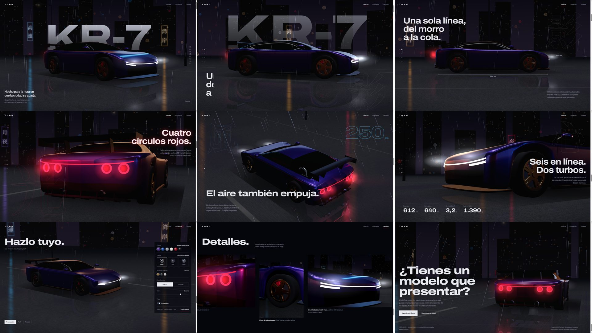

# YORU KR-7

Demo automotriz de cultura JDM nocturna: el YORU KR-7, un build ficticio sobre base Skyline R34, presentado con historia por scroll, configurador 3D y galería de detalles renderizada en tiempo real, en una calle de Tokio mojada.



## Ejecutar

```bash
npm install
npm run dev       # http://localhost:5173
npm run build     # genera dist/
npm run preview   # sirve dist/
```

`dist/` es estático: se puede subir tal cual a cualquier hosting (Netlify, Vercel, GitHub Pages, un bucket).

Parámetros útiles en la URL:

- `?q=low` fuerza la calidad baja (la que usan los móviles); `?q=high`, la alta.
- `#c=azul.tetsu.plata.ducktail.-20.1` abre el configurador con esa combinación (es lo que copia el botón «Copiar enlace»).

## Estructura

```
index.html                 secciones y textos
src/main.js                arranque, Lenis, bucle único de render, intro
src/choreo.js              planos de cámara por sección e interpolación por scroll
src/chapters.js            efectos DOM de la historia (cotas, velocidad, cifras, raíl)
src/configurator.js        controles, giro con arrastre, enlace compartible
src/gallery.js             fotos de detalle renderizadas desde la escena + scroll horizontal
src/three/stage.js         escena, luces, calidad adaptativa, enfoque y titular
src/three/car.js           R34: normalización, materiales, ejes, pilotos, sin emblemas
src/three/wheels.js        llantas procedurales alternativas (montadas en los neumáticos reales)
src/three/road.js          asfalto PBR mojado con reflejo planar, farolas y conos de luz
src/three/city.js          edificios, rotulación, postes, máquinas expendedoras, cielo
src/three/rain.js          lluvia iluminada y salpicaduras
src/three/post.js          profundidad de campo, bloom, lente, SMAA
src/three/reflector.js     reflejo planar del suelo
src/three/environment.js   mapa de entorno (HDRI + softboxes)
src/style.css, sections.css
src/fonts-ja.css           generado por scripts/subset-kanji-css.py
```

Si cambias textos en japonés, vuelve a generar `src/fonts-ja.css`:

```bash
python scripts/subset-kanji-css.py
```

## Recursos de terceros

- Coche: [«Nissan GTR R34 Skyline»](https://sketchfab.com/3d-models/nissan-gtr-r34-skyline-gt-r-skyline-5eed440cfd094c5a8fdc9929eb43ab02) de Pooya_dh, CC BY 4.0. Comprimido con glTF-Transform (meshopt + WebP) y sin emblemas de Nissan, GT-R ni SKYLINE. El crédito aparece en el pie de la página.
- Asfalto `asphalt_01` y HDRI `shanghai_bund`: Poly Haven, CC0.

La versión procedural original está en la etiqueta `baseline-procedural`.

## Contacto de la demo

El botón «Agenda una demo» apunta a `mailto:hola@tuestudio.com`. Cámbialo en `index.html` por el correo real del estudio.

Más detalle sobre decisiones, rendimiento y validación en [FINAL_REPORT.md](FINAL_REPORT.md).
